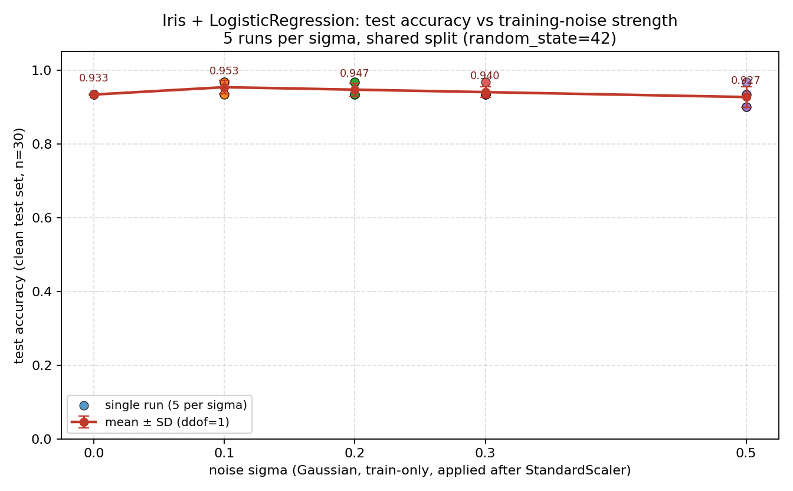

# Iris 加噪实验

这个案例展示 Weave 如何把一个研究问题拆成任务，再把实验产出和核验结果连回原来的问题。我们用鸢尾花数据检验：给训练特征加入不同强度的高斯噪声，逻辑回归在干净测试集上的分类准确率会怎么变？

| Bot | 演示中保存的成果 |
| --- | --- |
| 目标 | 在「实验目标与任务清单」整理阶段任务与依赖，并核验 25 次主实验的逐次结果和汇总。 |
| 笔记 | 在「背景知识笔记」整理 Iris、逻辑回归与高斯噪声的背景，记录实验口径和结果对照。 |
| 思维导图 | 用「研究关系导图」连接研究问题、变量、假设、实验方法和结果。 |
| 点子 | 在「假设与验证设计」记录可检验的假设，包括准确率是否整体下降、低噪声下是否接近基线、损失是否集中在高噪声时。 |
| 工程台 | 保存 Python 脚本、运行结果、结果校验和假设判定，另用第二组种子做稳健性补跑。 |

## 实验结果

数据来自 scikit-learn 内置的 Iris 数据集。全部实验共用同一个分层划分（训练集 120 条，测试集 30 条）。标准化器在干净训练集上拟合，噪声只加在标准化后的训练特征上。五种噪声强度各重复五次。

| 噪声标准差 σ | 主实验平均准确率 | 补跑平均准确率 |
| --- | ---: | ---: |
| 0.0 | 93.33% | 93.33% |
| 0.1 | 95.33% | 94.67% |
| 0.2 | 94.67% | 94.00% |
| 0.3 | 94.00% | 94.67% |
| 0.5 | 92.67% | 94.00% |

在这个固定划分上，两组结果都没有随噪声强度单调下降。主实验在最高噪声下比基线低 0.67 个百分点，改用另一组种子后则高 0.67 个百分点。结论限于这组实验条件。



- 主实验：[脚本](outputs/noise_logreg_experiment.py)、[25 次逐次数据](outputs/results_per_run.csv)、[五组汇总](outputs/results_summary.csv)。
- 稳健性补跑：[脚本](outputs/robustness_seed1base.py)、[25 次逐次数据](outputs/robustness_seed1base_per_run.csv)、[五组汇总](outputs/robustness_seed1base_summary.csv)、[两组种子对照](outputs/robustness_seed1base_compare.csv)、[曲线](outputs/robustness_seed1base.png)。

## 本地复跑

用 Python 3.12 在 `docs/demos/iris-noise/` 下运行以下命令。脚本会把重新生成的 CSV、图表和日志写入 `outputs/`。补跑脚本使用主实验 CSV 生成种子对照。

```sh
python -m pip install -r requirements.txt
python outputs/noise_logreg_experiment.py
python outputs/robustness_seed1base.py
```

这份案例可直接在 GitHub 上阅读，也可独立复跑实验。
